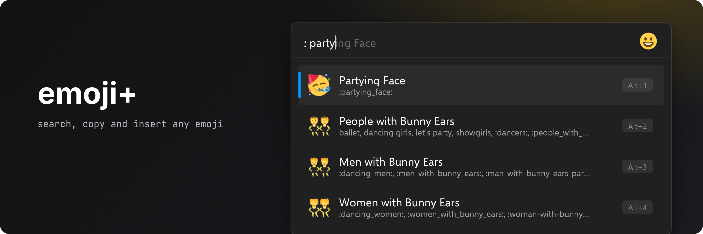

<!-- generated by readwright from docs/README.md.j2; edit the template, not this file -->


# Emoji+

Search and copy the right Emoji for any occasion.

[](https://github.com/Garulf/Emoji-plus/actions/workflows/tests.yml) [](https://github.com/Garulf/Emoji-plus/releases/latest) [](https://github.com/Garulf/Emoji-plus/releases/latest)

[](https://www.buymeacoffee.com/garulf) [](https://github.com/sponsors/Garulf)

## Features

* **Over 3,500 emoji.** Each one is searchable by name, common aliases and shortcodes.
* **Search any way you remember it.** `: heart`, `: love` and `: :heart_eyes:` all work.
* **Insert or copy.** Pick an emoji and it is typed into the window you were using, or copied to the clipboard.
* **Emojipedia one click away.** The context menu links to the emoji's Emojipedia page.

## Usage

Type `:` followed by part of an emoji's name, an alias or a shortcode, then press `Enter`:

```
: heart
```


Shortcodes like the ones in Slack and GitHub work too:


Open the context menu (`Shift+Enter` or right-click) to copy the emoji instead of inserting it, or to open
it on Emojipedia.org.

## Installation

### Flow Launcher

In Flow Launcher, type:

```
pm install Emoji+
```


### Manual installation

Download `Emoji-plus-<version>.zip` from the [latest release](https://github.com/Garulf/Emoji-plus/releases/latest) and unzip it into
`%appdata%\FlowLauncher\Plugins`, then restart Flow Launcher.

Pre-releases of the next version are published from the open release PR on the
[releases page](https://github.com/Garulf/Emoji-plus/releases) for testing. Flow Launcher won't offer them as updates.

## Configuration

Open **Settings → Plugins → Emoji+** in Flow Launcher:

| Setting | Default | Description |
| --- | --- | --- |
| Auto Insert | on | Type the emoji into the last active window. When off, the emoji is only copied to the clipboard |

## Requirements

* Flow Launcher 1.17.0 or newer
* Python 3.8 or newer, which Flow Launcher can install for you

## Changelog

See [CHANGELOG.md](CHANGELOG.md) for the full history.
